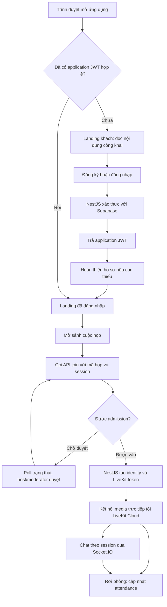

# Real-time Stream — luồng hoạt động của hệ thống

Tài liệu này mô tả luồng đang có trong source: ứng dụng React/Vite, API NestJS,
Supabase và LiveKit Cloud. Đây là hướng dẫn đọc code, không phải thiết kế cho các
workflow chưa triển khai.

## 1. Tổng quan kiến trúc

```text
Trình duyệt (React / Vite)
  ├─ Landing công khai ── GET /api/public/* ───────────────┐
  ├─ Đăng ký / đăng nhập ─ POST /api/auth/* ───────────────┤
  ├─ Hồ sơ sinh viên ───── GET/PATCH /api/users/me/profile ┤
  ├─ Sảnh / điều khiển ─── REST /api/meetings/* ───────────┤
  ├─ Chat ──────────────── Socket.IO /chat ────────────────┤
  └─ Media ─────────────── LiveKit client SDK ──────────┐  │
                                                        │  │
NestJS API                                               │  │
  ├─ Auth / Users / JWT                                  │  │
  ├─ Meetings / Admission / Attendance / Roles           │  │
  ├─ LiveKit token và quản trị participant ──────────────┤  │
  ├─ Chat gateway / access / repository                  │  │
  └─ Public content                                      │  │
       ├─ Supabase (dữ liệu và cấu hình server-side) ◀───┘  │
       └─ LiveKit Cloud (media room) ◀─────────────────────┘
```

Frontend không truy cập Supabase trực tiếp. NestJS đọc/ghi dữ liệu qua
`SupabaseService`; khóa Supabase và LiveKit server secret chỉ được dùng phía
backend. Trình duyệt nhận application JWT sau đăng nhập và LiveKit participant
token sau khi được phép vào phiên.

### Sơ đồ nhanh để trình bày



Khi trình bày, nhấn mạnh hai kết nối khác nhau: API/auth/chat đi qua NestJS;
audio/video đi thẳng từ trình duyệt tới LiveKit Cloud sau khi backend cấp token.
Supabase là nơi NestJS đọc/ghi dữ liệu, không được gọi trực tiếp từ frontend.

## 2. Khởi động ứng dụng

### Backend

1. `backend/src/main.ts` tạo Nest app từ `AppModule`.
2. `ConfigModule` chạy `validateEnvironment` trong
   `backend/src/config/environment.ts`.
3. Backend yêu cầu `SUPABASE_URL`, `SUPABASE_SECRET_KEY` và `JWT_SECRET`
   (tối thiểu 32 ký tự); kiểm tra URL, port, frontend origin, LiveKit URL/TTL,
   tên phòng PoC và không cho bật PoC cố định ở production.
4. `configureApp` gắn `/api`, bật validation toàn cục
   (`transform`, `whitelist`, từ chối field không khai báo), CORS cho
   `FRONTEND_URL` và shutdown hooks.
5. `SupabaseModule` tạo Supabase client server-side. Các module auth, LiveKit,
   chat, meetings và public content được đăng ký tại `AppModule`.
6. API mặc định nghe tại `127.0.0.1:3000`; `GET /api/health` chỉ kiểm tra
   liveness, không xác minh kết nối LiveKit.

Lỗi bootstrap được báo bằng thông điệp chung; log không in environment hoặc
SDK error có thể chứa credential.

### Frontend và local proxy

`frontend/src/main.tsx` mount `App`. Vite chạy frontend ở `127.0.0.1:5173`;
preview ở `127.0.0.1:4173`. Vite proxy `/api` và `/socket.io` về backend
(`API_PROXY_TARGET`, mặc định `http://127.0.0.1:3000`). Nếu cấu hình
`VITE_API_URL` thì service frontend gọi API bằng URL đó; để trống thì gọi cùng
origin.

## 3. Mở ứng dụng, đăng nhập và hồ sơ

### Chọn màn hình ban đầu

`frontend/src/App.tsx` xem query string:

- Mặc định hoặc query không có phiên hợp lệ: hiển thị `GuestLanding`.
- `?mode=login` và `?mode=register`: mở form tương ứng, kể cả khi tab còn lưu
  phiên cũ.
- Nếu có application JWT còn hạn trong `sessionStorage`, mở `AuthApp`.

### Đăng ký / đăng nhập

1. `AuthApp` kiểm tra input phía client, chặn submit lặp, timeout và hủy request
   khi component unmount.
2. `auth-api.ts` gửi `POST /api/auth/register` hoặc
   `POST /api/auth/login`.
3. `AuthController` áp dụng rate limit cho auth endpoints; DTO chuẩn hóa email
   về lowercase, trim tên đăng ký và validate payload.
4. `AuthService` tra bảng `users` qua `UsersService`. Đăng ký kiểm tra email
   trùng, hash mật khẩu bằng bcrypt; đăng nhập so sánh bcrypt hash. Sai email và
   sai mật khẩu cùng trả thông báo chung.
5. `AuthService` ký application JWT HS256 (hạn một ngày) với `sub` là user ID.
   Phản hồi chỉ có token và thông tin user công khai, không trả password hash.
6. Frontend lưu phiên theo tab trong `sessionStorage`; thiết lập timer đăng
   xuất khi token hết hạn. JWT không được lưu ở localStorage.

### Hồ sơ sinh viên

Sau đăng ký mới, ứng dụng đưa người dùng tới `PersonalProfile`. Khi đăng nhập,
profile được tải trước; hồ sơ đủ trường thì người dùng tiếp tục, chưa đủ thì
phải hoàn thiện và lưu mới đi tiếp.

`GET/PATCH /api/users/me/profile` được bảo vệ bởi `JwtAuthGuard`. Guard xác minh
JWT, `JwtStrategy` tải lại user hiện hành từ Supabase rồi gắn user vào request;
`CurrentUser` lấy user đó cho controller. `UsersService` đọc/UPSERT
`student_profiles`. Frontend coi các trường họ tên, mã sinh viên, trường/khoa,
ngành và khóa là bắt buộc; backend DTO giới hạn độ dài các trường.

Sau profile, người dùng vào landing đã đăng nhập. Họ chỉ mở giao diện meeting
khi chọn nút **Cuộc họp**. Logout xóa phiên và query điều hướng meeting.

## 4. Landing và nội dung công khai

`GuestLanding` tải riêng ba bộ sưu tập, mỗi bộ qua `usePublicContent`:

| Frontend | API | Nguồn Supabase |
| --- | --- | --- |
| Câu lạc bộ | `GET /api/public/clubs?page=&limit=` | `public_clubs` |
| Hoạt động | `GET /api/public/activities?page=&limit=` | `public_club_activities` |
| Bài viết | `GET /api/public/posts?page=&limit=` | `public_club_posts` |

`PublicContentController` giới hạn pagination và rate limit. Service chỉ đọc
các public view được allowlist, chọn cột công khai, sắp xếp theo thời gian
publish và trả `{items, page, limit, total, hasMore}`. Không có fallback sang
bảng riêng tư hay dữ liệu mẫu khi API lỗi. Frontend hỗ trợ retry, tải trang
tiếp, tìm CLB, chi tiết nội dung và chỉ cho phép URL ảnh/link HTTP(S).

Các nút **Quan tâm** hiện yêu cầu đăng nhập; việc theo dõi CLB, đăng ký hoạt
động và workflow quản trị CLB chưa được backend hiện tại thực hiện.

### Gợi ý mở rộng: trang thông tin riêng cho mỗi CLB

Hiện nút **Xem CLB** và tên CLB mở `ContentDialog` ngay trên landing, dùng dữ
liệu có sẵn từ danh sách đã tải. Cách này phù hợp để xem nhanh, nhưng chưa tạo
được đường dẫn riêng để chia sẻ hoặc tải lại trang chi tiết.

Có thể phát triển trang chi tiết theo luồng sau:

1. Khi chọn **Xem CLB**, điều hướng tới URL ổn định như
   `/clubs/<club_id>`; dùng ID thay vì tên để tránh lỗi dấu, đổi tên hoặc tên
   trùng. Nếu dự án chưa có router, có thể tạm dùng query
   `/?club=<club_id>` và đồng bộ điều hướng với browser history.
2. Tạo `ClubDetailPage` riêng. Khi trang mở hoặc được tải lại, lấy `club_id`
   từ URL và gọi `GET /api/public/clubs/:clubId`.
3. Thêm endpoint này vào `PublicContentController` và một hàm tương ứng trong
   `PublicContentService`. Service chỉ đọc đúng public view được allowlist,
   giới hạn cột trả về và chỉ trả CLB đang được công khai; không truy vấn thẳng
   bảng riêng tư.
4. Hiển thị ảnh cover/logo, tên, giới thiệu, sứ mệnh và thông tin liên hệ nếu
   có. Bên dưới có thể tải các hoạt động và bài viết của CLB theo từng trang,
   dùng các public view hiện có và lọc theo `club_id`.
5. Có trạng thái đang tải, lỗi kèm nút thử lại, trường hợp CLB không tồn tại
   hoặc chưa công khai, và nút quay về danh sách. Trên điện thoại, xếp nội dung
   thành một cột; giữ URL để người dùng chia sẻ hoặc tải lại trang.
6. Giữ **Quan tâm** ở trạng thái yêu cầu đăng nhập cho tới khi backend có API
   theo dõi CLB thật. Việc đăng ký hoạt động cũng cần endpoint và kiểm tra quyền
   riêng; không mô phỏng thành công chỉ từ giao diện.

Phạm vi đề xuất chỉ là đọc thông tin công khai. Trước khi triển khai, kiểm tra
view Supabase hiện có những cột nào; chỉ bổ sung migration/view hoặc workflow
ghi dữ liệu nếu được yêu cầu riêng. Các file dự kiến liên quan là
`GuestLanding.tsx`, component trang chi tiết mới,
`public-content.ts`, `PublicContentController` và `PublicContentService`.

## 5. Tạo hoặc mở cuộc họp

Sảnh ở `MeetingPage` mở qua `/?view=meeting` trong ứng dụng đã đăng nhập.
Mã có thể nhập trực tiếp hoặc lấy từ query `meeting`; parser chấp nhận mã 10
chữ/số hoặc link mời chứa query `meeting`.

### Tạo mới

- **Họp ngay**: `POST /api/meetings/quick` tạo meeting, thêm creator với role
  `host`, tạo session trạng thái `ongoing` và gán tên room LiveKit riêng cho
  session. Room thực tế được LiveKit mở khi participant kết nối. Frontend tải
  overview rồi tự gửi yêu cầu join như thành viên chủ phòng.
- **Lên lịch**: `POST /api/meetings` tạo meeting và membership chủ phòng.
  Nếu nhập lịch, frontend gọi tiếp
  `POST /api/meetings/:meetingId/sessions`. Session phải bắt đầu trong tương
  lai và kết thúc sau giờ bắt đầu.
- Meeting lặp dùng một tập con RFC 5545 RRULE được kiểm tra và giới hạn số lần
  sinh. Cuộc họp không lặp chỉ có một session; các mốc bắt đầu đã tồn tại
  không được tạo trùng.

Room chính thức được đặt tên theo session (`session-<sessionId>`), không dùng
một room chung cho các cuộc họp trong luồng này. `GET
/api/meetings/:code/sessions` trả meeting overview và danh sách session. UI
refresh định kỳ để cập nhật trạng thái.

### Quyền vào phiên (admission)

Khi nhấn **Tham gia**, `useSessionFlow` gọi
`POST /api/meetings/:code/join` với `sessionId`:

1. Backend tìm meeting/session, từ chối session đã kết thúc. Session scheduled
   chỉ được kích hoạt khi đã tới giờ; session ongoing tiếp tục nhận người vào.
2. Thành viên đã admitted (chủ phòng/thành viên được mời/khách đã duyệt) có thể
   đi tiếp.
3. Người chưa là thành viên được thêm thành participant. Nếu bật waiting room,
   trạng thái là `pending` và **chưa có attendance hoặc LiveKit token**. Nếu tắt,
   khách mới được admitted ngay.
4. Frontend hiển thị trạng thái chờ và chỉ poll
   `GET /api/meetings/:meetingId/sessions/:sessionId/join-status`; không gửi
   lại yêu cầu gia nhập trong lúc đang chờ.
5. Host hoặc moderator xử lý yêu cầu qua
   `GET .../join-requests`,
   `POST .../join-requests/:memberId/approve` hoặc `/deny`. Khi được duyệt,
   frontend gọi join lại để lấy credentials. Có giới hạn lượt bị từ chối và
   cooldown.
6. Backend tạo identity riêng cho kết nối, ký token LiveKit với room và quyền
   từ membership, rồi ghi attendance gắn với identity và session. Quyền screen
   share mặc định chỉ cấp cho host là chủ sở hữu cuộc họp.

Các bước này nằm trong `MeetingsController`, `MeetingsService` và
`useSessionFlow`; không dựa vào quyền do client tự khai.

## 6. Kết nối LiveKit, media và vòng đời session

Sau khi nhận credentials, `MeetingPage` tải lazy `MeetingRoom`. Component dùng
`LiveKitRoom` từ LiveKit React SDK để kết nối trực tiếp LiveKit Cloud; NestJS
không relay audio/video. SDK quản lý signaling, track và participant state.

- Microphone/camera có toggle và chọn thiết bị; lỗi được hiển thị riêng theo
  loại thiết bị. Trạng thái bật/tắt được nhớ theo tab.
- Audio nhận từ phòng có thể mute riêng. Một số trình duyệt cho chọn output.
- Camera dùng grid khi không có người share. Khi có screen share, `ScreenShareStage`
  hiển thị màn hình, camera thành viên nằm ở sidebar; có thể chọn giữa nhiều
  người share.
- Giơ tay là participant attribute trên LiveKit, không phải bản ghi Supabase.
- Chia sẻ màn hình của host có thể bắt đầu trực tiếp. Thành viên khác gửi
  `screenShareRequest`; host quyết định qua
  `POST /api/meetings/:meetingId/sessions/:sessionId/screen-share/decision`.
  Backend xác minh host, session, attendance, trạng thái request rồi cập nhật
  permission của đúng LiveKit identity.
- Browser cần secure context (HTTPS hoặc localhost) để truy cập media.

### Rời, kết thúc và khôi phục

- **Rời phòng** gọi `POST
  /api/meetings/:meetingId/sessions/:sessionId/leave` với đúng `attendanceId`.
  Backend ngắt participant nếu còn trong LiveKit rồi cập nhật `left_at`.
  Gọi lặp lại sau khi đã rời được xử lý idempotent.
- Nếu kết nối bị đóng hoặc trang bị đóng, frontend cố ghi nhận departure.
  Trước join mới, hook thử hoàn tất departure cũ.
- Phiên đang tham gia có thể được nhớ trong `sessionStorage`; khi tải lại đúng
  user, meeting và session, frontend xin credentials mới thay vì dùng token cũ.
- Thành viên dài hạn có thể gọi `POST .../end`. Backend đóng attendance đang mở,
  ngắt participant, hết hạn quyền guest chỉ dùng cho session đó và chuyển session
  sang `ended`.
- Khi host/moderator loại thành viên, backend ngắt các identity đang hoạt động,
  đóng attendance và đánh dấu membership đã bị loại.

`GET /api/meeting-sessions` là endpoint phụ liệt kê session ongoing mà user đã
được admitted; meeting UI hiện tại tập trung gọi `/api/meetings/*`.

## 7. Chat theo session

Chat chỉ được mở khi credentials có `sessionId` và LiveKit connection đang
connected. Phòng PoC không gắn session sẽ không có chat.

```text
MeetingChat
  └─ socket.io-client → namespace /chat (WebSocket)
       ├─ handshake: application JWT + sessionId + participantIdentity
       ├─ chat:history → lịch sử theo cursor
       ├─ chat:send → validate → lưu Supabase → emit chat:message
       └─ chat:revoked → đóng kết nối nếu hết quyền
```

`ChatAccessService` xác minh application JWT, kiểm tra identity bắt đầu bằng
user ID trong token, xác nhận user còn tồn tại, session ongoing, membership
admitted/chưa bị loại và participant identity thực sự đang kết nối trong room
LiveKit. Backend kiểm tra lại quyền khi gửi/đọc lịch sử, định kỳ mỗi 30 giây
và trước khi phát tin cho từng người nhận.

`ChatService` validate message, giới hạn 2.000 ký tự, áp rate limit in-memory
cho gửi/lịch sử. `ChatRepository` ghi và đọc bảng `meeting_messages`; mỗi tin
gắn session, sender và `clientMessageId`. Unique key giúp retry trả lại tin cũ
thay vì ghi đè nội dung. Lịch sử phân trang theo `(created_at, message_id)`,
tối đa 50 tin mỗi trang. Migration
[`20261108000100_create_meeting_messages.sql`](./supabase/migrations/20261108000100_create_meeting_messages.sql)
giới hạn quyền DB cho backend/service role.

Frontend đồng bộ lịch sử sau connect/reconnect, chống trùng theo message ID,
giữ outbox khi acknowledgment lỗi, cho tải tin cũ và đếm tin chưa đọc khi panel
đóng. Server mới là nguồn xác nhận tin đã lưu.

## 8. Quản trị meeting và API

Các endpoint bên dưới có prefix `/api`; trừ health và public content, nhóm
meeting yêu cầu `Authorization: Bearer <application JWT>`.

| Endpoint | Mục đích |
| --- | --- |
| `GET /health` | Liveness |
| `POST /auth/register`, `POST /auth/login`, `GET /auth/me` | Tài khoản và xác thực |
| `GET/PATCH /users/me/profile` | Hồ sơ người dùng hiện hành |
| `GET /public/{clubs,activities,posts}` | Nội dung công khai có pagination |
| `POST /meetings`, `POST /meetings/quick` | Tạo meeting thường hoặc nhanh |
| `GET /meetings/:code/sessions` | Đọc meeting overview và sessions |
| `POST /meetings/:meetingId/sessions` | Tạo lịch/session |
| `POST /meetings/:code/join`, `GET /meetings/:meetingId/sessions/:sessionId/join-status` | Xin vào và xem trạng thái admission |
| `GET/POST /meetings/:meetingId/sessions/:sessionId/join-requests/...` | Liệt kê, duyệt hoặc từ chối khách |
| `POST /meetings/:meetingId/members`, `PATCH .../moderator` | Mời member dài hạn, đổi moderator |
| `PATCH /meetings/:meetingId/settings` | Cài đặt waiting room |
| `POST /meetings/:meetingId/sessions/:sessionId/members/:memberId/mute` | Moderator mute microphone đang publish |
| `POST /meetings/:meetingId/members/:memberId/remove` | Loại member và ngắt các kết nối hiện tại |
| `POST /meetings/:meetingId/sessions/:sessionId/leave` | Đóng attendance khi user rời |
| `POST /meetings/:meetingId/sessions/:sessionId/end` | Kết thúc session |
| `POST /meetings/:meetingId/sessions/:sessionId/screen-share/decision` | Host duyệt/từ chối quyền share |
| `GET /meeting-sessions` | Liệt kê session ongoing user được tham gia |
| `POST /livekit/token` | Endpoint token PoC/compatibility, xem lưu ý bên dưới |

Quyền được kiểm tra lại ở service, không chỉ ẩn nút trên UI. Host được bảo vệ
không bị hạ role/loại; moderator và participant bị giới hạn theo role, membership
và trạng thái admitted. DTO cùng global validation pipe từ chối field thừa và
giá trị sai định dạng.

## 9. Hai đường cấp LiveKit token — cần phân biệt

Đường đang dùng bởi sảnh meeting là
`POST /api/meetings/:code/join`. Đường này xác minh session, admission, role,
ghi attendance và tạo room riêng cho session.

`POST /api/livekit/token` là endpoint PoC/compatibility:

- Không có `sessionId`: cấp token cho room tĩnh `LIVEKIT_ROOM_NAME`, chỉ khi
  `POC_ENABLED=true`; không dùng đường này để vào một meeting có admission.
- Có `sessionId`: service dùng lại membership/session policy hiện hành.
- `useMeetingSession` và `token-api.ts` là client hook/service cũ hoặc độc lập;
  test của `MeetingPage` xác nhận meeting UI chính không gọi `/livekit/token`
  hay `/meeting-sessions`.

Không nên suy từ sự tồn tại của token endpoint cố định rằng các cuộc họp chính
đang dùng chung một LiveKit room.

## 10. Cấu trúc source và kiểm thử

| Khu vực | Trách nhiệm |
| --- | --- |
| [`backend/src/auth`](./backend/src/auth) | DTO, register/login, JWT strategy và guard |
| [`backend/src/users`](./backend/src/users) | User lookup và student profile |
| [`backend/src/supabase`](./backend/src/supabase) | Supabase server client |
| [`backend/src/meetings`](./backend/src/meetings) | Meeting/session, admission, attendance, role controls |
| [`backend/src/livekit`](./backend/src/livekit) | Token PoC/compatibility và permission mapping |
| [`backend/src/chat`](./backend/src/chat) | WebSocket gateway, access check, chat service/repository |
| [`backend/src/public-content`](./backend/src/public-content) | Public view allowlist và pagination |
| [`frontend/src/features/auth`](./frontend/src/features/auth) | Form đăng nhập/đăng ký, session và profile |
| [`frontend/src/features/guest`](./frontend/src/features/guest) | Landing và nội dung public |
| [`frontend/src/features/meeting`](./frontend/src/features/meeting) | Lobby, session flow, media room và quản trị |
| [`frontend/src/features/meeting/chat`](./frontend/src/features/meeting/chat) | Chat client, hook và panel |

Backend tests trong `backend/test` bao phủ auth, token, admission, leave,
scheduling, role và screen-share. Frontend Vitest tests bao phủ routing/auth,
landing, meeting API/session resume, theme, media preferences và room/chat UI.
Root scripts `npm test`, `npm run typecheck`, `npm run build` chạy theo
workspaces backend/frontend.

## 11. Trạng thái và giới hạn cần nhớ

- `AGENTS.md`/roadmap có thể chứa mô tả PoC cũ; source hiện có thêm auth,
  profile, meeting session/admission, chat và public-content như mô tả trên.
- Phase 03/04/05/06 được ghi nhận là **In Progress** trong tài liệu dự án.
  Unit tests/build không thay cho nghiệm thu với Supabase và LiveKit thật.
- Migration chat có trong source và phase docs nói đã được áp dụng/xác nhận,
  nhưng việc thử chat bằng fixtures không tương đương xác minh persistence mới
  trên DB thật. Cần đối chiếu môi trường Supabase được dùng khi nghiệm thu.
- Nghiệm thu media hai thiết bị/hai mạng và persistence chat thật vẫn là phần
  riêng cần kiểm tra.
- Trang guest hiện chỉ đọc dữ liệu qua public views; các chức năng CLB/hoạt động
  như đăng ký, tham gia hoặc quản trị chưa nằm trong luồng này.

## 12. Đọc tiếp

- [README](./README.md) — cài đặt, cấu hình và chạy.
- [Auth integration](./docs/modules/auth-integration.mdx) — chi tiết auth và DB.
- [Meeting chat](./docs/modules/meeting-chat.mdx) — chat và giới hạn nghiệm thu.
- [Module 1 Media PoC](./docs/modules/module-01-media-poc.mdx) — hợp đồng PoC.
- [Master plan](./docs/plans/master-plan.mdx) — trạng thái phase.
