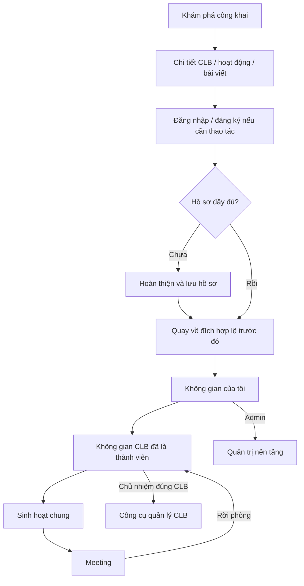

# Phase 1 — Khung trải nghiệm uniCircle

Ngày: 16/11/2026. Baseline mã nguồn: `final`, commit `76a9d34`.

Trạng thái: đã rà soát và dựng đề xuất có thể xem; chờ nhóm duyệt khung trước Phase 2.
Đây là phase thiết kế sản phẩm/frontend, không phải Phase 01 của roadmap PoC cũ.
Không thay đổi application code, API, schema, dữ liệu Supabase hoặc Git remote.

## 1. Những quyết định đã chốt với nhóm

- Trang đầu là khám phá có giới thiệu ngắn. Guest được xem nội dung public.
- Giữ navy/xanh và font Be Vietnam Pro, tinh chỉnh tính nhất quán; không chuyển sang đỏ.
- Đăng ký xong bắt buộc hoàn thiện hồ sơ sinh viên trước khi vào khu vực tài khoản.
- Nếu đăng xuất/đóng tab trước khi hoàn tất, lần đăng nhập sau quay lại onboarding.
- Tài khoản chưa hoàn thiện không gọi là guest: đây là account đang onboarding.
- Chủ nhiệm/member là quyền theo từng CLB. Admin là quyền nền tảng.
- Chủ nhiệm tạo hoạt động được đăng ngay; thành viên thường gửi duyệt.
- Đề nghị CLB đã bị từ chối giữ kết quả để tra cứu; lần tiếp theo tạo đề nghị mới, không sửa/gửi lại cùng hồ sơ.
- Dữ liệu demo do nhóm tạo, có logo/ảnh và nội dung đủ thật để kiểm thử. Không tự nhận đại diện chính thức cho CLB thật.
- Phát triển trên base React/Vite/NestJS/Supabase/LiveKit hiện có, không viết lại meeting.

## 2. Chẩn đoán mã nguồn hiện tại

| Quan sát trong code | Tác động | Hướng xử lý |
| --- | --- | --- |
| App.tsx chọn AuthApp bằng query mode và restoreSession | Không có cây route rõ; đăng nhập làm đổi cả khung hiển thị | Router và SessionProvider ở app, route độc lập với khung |
| GuestLanding giữ adminPage, clubRoute, modal, đề nghị CLB và dữ liệu public | Component biết quá nhiều nghiệp vụ | DiscoveryPage chỉ điều phối các section public |
| Điều hướng trộn hash, query, pushState và boolean | Back/refresh/deep link khó kiểm soát, admin route không phục hồi nhất quán | Một nguồn sự thật là URL và router |
| Chi tiết public nằm trong ContentDialog | Khó chia sẻ link riêng, phục hồi nội dung sau đăng nhập | Route detail; modal chỉ cho xác nhận/xem nhanh |
| CLB của tôi, admin và meeting cùng header public | Không rõ người dùng đang khám phá hay vận hành | Cá nhân qua My Space; công cụ CLB/admin nằm trong shell riêng |
| AuthApp chặn PersonalProfile trước mọi khu vực signed-in | Đã phù hợp quyết định onboarding của nhóm | Giữ quy tắc, chuyển thành route guard có trạng thái tải/lỗi rõ |
| API public đọc view allowlist; auth dùng Nest JWT, đọc lại user | Có nền tốt để tái sử dụng | Giữ service backend và ranh giới bảo mật |
| student_code DTO/UI 40 ký tự, migration trước giới hạn 32 | Form chấp nhận dữ liệu DB từ chối | Hợp nhất contract trước nối form mới |
| Service hoạt động dùng rejected và chủ nhiệm tạo thì tự duyệt | Không khớp hoàn toàn migration trước dùng changes_requested | Đối chiếu catalog DB thật và chốt hành vi trước Phase 4 |
| API tạo CLB có ảnh URL nhưng chưa có upload/lĩnh vực/đơn vị | UI không được giả định đã có quản lý media/phân loại đầy đủ | Bổ sung API theo contract hoặc ghi rõ phần chưa có |

Rà soát này là source review. Không thực hiện đăng ký, duyệt, ghi dữ liệu hay kiểm chứng mọi nghiệp vụ trên database thật.

## 3. Bản đồ không gian



Không bắt người dùng đi qua My Space nếu họ đang tiếp tục hành động tại trang chi tiết. My Space là đích mặc định khi đăng nhập không có returnTo.

### Bốn layout

- PublicLayout: header ngang + nội dung + footer. Guest: login/register. Signed-in: link My Space/avatar; admin không chiếm navigation public.
- PersonalLayout: sidebar cá nhân + nội dung. Link quay lại khám phá luôn thấy.
- ClubLayout: tên/logo CLB + chuyển CLB + sidebar có nhóm sinh hoạt/quản lý theo quyền.
- AdminLayout: nhãn Quản trị hệ thống + queue và bảng; tách khỏi quản lý một CLB.
- AuthLayout và MeetingLayout là shell chuyên biệt: form không mang sidebar; cuộc gọi tối ưu media, có nơi quay về.

### Quy tắc đặt tên

- Public: Khám phá / Câu lạc bộ / Hoạt động / Bài viết.
- Personal: Không gian của tôi / CLB tham gia / Đang quan tâm / Hoạt động đã đăng ký / Đề nghị CLB / Hồ sơ.
- Club: Không gian [tên CLB]. Chủ nhiệm vẫn là thành viên sử dụng cùng không gian.
- Admin: Quản trị hệ thống, không gọi chung là Quản lý CLB.
- Dùng Đề nghị thành lập CLB thay cho Thêm CLB; đây là yêu cầu cần xét duyệt.

## 4. Danh mục route đề xuất

Các route dưới đây là thiết kế đích, chưa được cài vào app. ID dùng UUID hiện có, không yêu cầu slug.

| Route | Màn hình / hành động chính | Quyền |
| --- | --- | --- |
| / | Khám phá, tìm cộng đồng / xem hoạt động | Public |
| /clubs | Danh sách, tìm và lọc CLB | Public |
| /clubs/:clubId | Hồ sơ CLB, quan tâm, liên hệ | Đọc public; ghi cần account hoàn chỉnh |
| /activities | Danh sách hoạt động, ngày và lĩnh vực | Public |
| /activities/:activityId | Chi tiết, trạng thái đăng ký | Đọc public; đăng ký cần account hoàn chỉnh |
| /posts và /posts/:postId | Danh sách và bài viết | Public |
| /about | Giới thiệu ngắn, liên kết đề nghị CLB | Public |
| /login và /register | Xác thực, lưu đích tiếp tục | Guest hoặc chuyển hướng account hợp lệ |
| /onboarding | Hồ sơ bắt buộc, lưu rồi tiếp tục | Account chưa hoàn thiện |
| /me | Lịch sắp tới, CLB tham gia, việc cần xử lý | Account hoàn chỉnh |
| /me/clubs | CLB đã tham gia, vai trò mỗi CLB | Account hoàn chỉnh |
| /me/follows | CLB quan tâm, không phải membership | Account hoàn chỉnh |
| /me/registrations | Hoạt động đã đăng ký | Account hoàn chỉnh |
| /me/club-requests | Danh sách đề nghị + tạo đề nghị mới | Account hoàn chỉnh |
| /me/club-requests/new và /me/club-requests/:clubId | Soạn / theo dõi hồ sơ đề nghị | Chủ sở hữu đề nghị |
| /me/profile | Hồ sơ; không trộn onboarding với settings | Account hoàn chỉnh |
| /workspace/:clubId | Tổng quan sinh hoạt CLB | Membership active + CLB published |
| /workspace/:clubId/activities | Hoạt động CLB, bài gửi của tôi | Như trên |
| /workspace/:clubId/posts | Bài viết CLB, bản nháp của tôi | Như trên; API cần bổ sung |
| /workspace/:clubId/meetings | Danh sách/tạo phòng | Thành viên theo scope đã chốt; giữ policy host riêng |
| /workspace/:clubId/manage/* | Nội dung cần duyệt, thành viên/ban, thông tin | Chủ nhiệm đúng CLB; một số API chưa có |
| /admin/club-requests và /admin/club-requests/:clubId | Queue và hồ sơ xét duyệt | Admin + hồ sơ hoàn chỉnh theo quy tắc chung hiện chốt |
| /admin/clubs | Danh sách CLB cấp nền tảng | Admin; không tự cho admin quyền chủ nhiệm |
| /meetings và /meetings/:meetingId/sessions/:sessionId | Lối họp độc lập / cuộc họp | Auth + quyền session hiện có |

Đăng xuất/hết phiên xóa cache cá nhân và quyền CLB. 403 không chuyển thành 404 một cách tùy tiện; trang không quyền có lối thoát. Item public bị ẩn/xóa trả trạng thái không còn khả dụng, không lộ bản nháp.

## 5. Các luồng phải giữ nguyên ý nghĩa

### Guest → account → tiếp tục

1. Guest xem chi tiết, bấm thao tác cần tài khoản.
2. Lưu returnTo nội bộ + loại thao tác; không lưu token vào URL.
3. Login/register; kiểm tra phiên từ backend, rồi kiểm tra profile.
4. Thiếu hồ sơ → onboarding; lưu thành công mới coi là hoàn tất, không tin cờ localStorage.
5. Quay lại đúng trang; hiển thị thao tác để người dùng xác nhận. Không tự POST lại một đăng ký có tác dụng phụ chỉ vì redirect.
6. Nếu đích không còn hợp lệ → thông báo và trở về My Space. Chặn open redirect bằng allowlist đường dẫn nội bộ.

Onboarding đủ trường theo hiện tại: full_name, student_code, school_or_faculty, major, cohort. Phone/bio tùy chọn. Lỗi tải profile khác với profile chưa đủ; không gán người dùng lỗi mạng thành guest. Logout vẫn có thể quay về khám phá công khai.

### Một người — nhiều CLB

Minh là chairperson SINNO và member HUROS. /me/clubs hiển thị cả hai, ghi vai trò. Khi đổi clubId: hủy request cũ, reset bộ lọc cần thiết, tải quyền mới, không tái dùng quyền SINNO cho HUROS. Shell hiện tên CLB ở mọi trang. Chỉ nhóm Quản lý thay đổi theo role, không đổi danh tính tài khoản.

### Đề nghị CLB → admin → công khai

Đề nghị nằm ở My Space, không phải membership hoặc follow. Pending chỉ có trang theo dõi; chưa mở workspace CLB published. Admin xem hồ sơ, duyệt/từ chối. Người gửi thấy trạng thái bằng refresh/polling hiện có; không giả vờ đã có notification realtime. Khi published mới hiện trong khám phá và mở workspace. Sự tồn tại membership do trigger tạo sớm không được dùng làm bằng chứng CLB đã duyệt.

### Meeting

Lưu returnTo tại lúc mở meeting, chỉ nhận đích nội bộ. Rời cuộc gọi quay về workspace/lịch/meeting hub tương ứng. Refresh/link mời vẫn xác thực lại session và membership theo policy meeting. Không tự gắn mọi meeting cũ vào một CLB: DB meeting hiện chưa có club_id; cần contract liên kết nếu muốn tạo phòng thuộc CLB thật.

## 6. Năng lực API hiện có và phần còn thiếu

Prefix thực tế /api. Có route không có nghĩa là đã kiểm thử production hay đủ phân quyền mọi tình huống.

| Nghiệp vụ | Hiện có trong code | Khoảng trống trước UI hoàn chỉnh |
| --- | --- | --- |
| Auth / profile | /auth/register, /auth/login, /auth/me; GET/PATCH /users/me/profile | Guard profile backend cho nghiệp vụ; role enum/NULL; đồng nhất giới hạn trường |
| Public | GET /public/clubs, /public/activities, /public/posts có phân trang | Detail theo ID, tìm kiếm/lọc server, taxonomy public; hiện search frontend chỉ lọc dữ liệu đã tải |
| Đề nghị CLB | POST /public/clubs; GET /public/clubs/mine | List hiện tối đa 20; cần hiển thị lịch sử nhiều đề nghị, tạo mới sau từ chối; upload/website/fanpage chưa là contract |
| Admin | GET /public/admin/clubs; PATCH approve/reject | Lấy chi tiết độc lập, lý do từ chối tùy chỉnh, phân trang thật, lịch sử quyết định |
| Membership | GET /my-clubs chỉ trả CLB published của người gọi | CRUD ban/thành viên, mời/gia nhập chưa có; không giả định có thể tự join |
| Hoạt động CLB | GET/POST /my-clubs/:clubId/activities; PATCH approve/reject | Edit nháp, đăng ký/điểm danh API, media/capacity/window đầy đủ; đối chiếu rejected |
| Quan tâm | Có bảng club_follows theo migration trước | Chưa thấy endpoint follow/unfollow |
| Bài đăng | Public read có | API nháp/gửi duyệt/chủ nhiệm duyệt chưa có |
| Meeting/chat meeting | Module hiện có | Club association/return context; không thay thế bằng UI fake |
| Chat nội bộ / tuyển dụng | Chưa trong scope | Chỉ định vị cho tương lai, không tạo menu chết |

## 7. Tổ chức frontend đích và quy tắc phụ thuộc

```text
src/
  app/ router/ layouts/ providers/
  features/
    auth/ profile/ discovery/ clubs/ activities/ posts/
    personal/ club-workspace/ admin/ meeting/
  shared/ ui/ api/ styles/ lib/
```

- app ghép route và provider; feature không import ngược app. shared không biết feature, role CLB hay Supabase table.
- Page điều phối; component trình bày; hook quản lý state/request; service chuyển DTO API thành kiểu UI. Không nhét fetch vào từng button/component con.
- club-workspace là khung ngữ cảnh; nghiệp vụ activity/post vẫn ở module tương ứng, tránh viết lại hai bộ form public/private.
- admin chứa use case xét duyệt nền tảng; không dùng ClubManagementPage hiện tại như shell CLB của chủ nhiệm.
- Chỉ trạng thái phiên/quyền và thông báo chung mới global; selection/filter tại route hoặc feature. Filter/page cần bookmark đưa vào search params.
- Cache private phải có khóa theo userId + clubId, xóa khi logout/đổi user. Không dùng role do frontend truyền lên làm nguồn cấp quyền.
- Đề xuất router có nested layouts (React Router); chọn phiên bản khi triển khai. Phase này không thêm dependency, không phát minh router riêng.
- Chưa bắt buộc thư viện state/cache. Chọn sau khi kiểm kê request, ưu tiên một cơ chế thống nhất, tránh framework bên trong framework.
- Fixture đặt riêng, dùng contract giống API và nhãn demo rõ. Không rải mock vào page, không success toast khi chưa có backend ghi.
- Tách CSS theo layout/feature, tokens chung; loại dần global main/header/button và selector phụ thuộc cấu trúc trang khác.
- Chuyển từng luồng: router+session → public → personal → workspace → admin; giữ adapter legacy meeting trong thời gian di chuyển.

## 8. Wireframe và hướng thị giác

Mở `phase-01-review/index.html` cạnh tài liệu này. Đây là storyboard độc lập có sáu màn hình chọn được, không chạy nghiệp vụ và không gọi DB.

Ý tưởng: bảng tin sinh hoạt Bách khoa được biên tập thành một cổng khám phá. Ảnh sự kiện/CLB làm chất liệu, ngày diễn ra và CLB tổ chức làm nhịp; không dùng ảnh dashboard giả.

- Navy #152c50 làm màu chữ/thương hiệu; xanh #285fba là hành động chính. Nền trắng/xám lạnh nhẹ.
- Be Vietnam Pro giữ từ dự án; body 16px, metadata đủ đọc, không cần đổi font khi vào admin.
- Public: giới thiệu ngắn, một ảnh chủ đạo, hoạt động sắp tới, CLB theo lĩnh vực, bài viết, liên kết đề nghị CLB ở footer.
- Featured là chọn biên tập, không tự bật CLB mới nhất lên hero; danh sách chuẩn sort có quy tắc.
- Personal/workspace/admin: title vừa phải, sidebar sáng, bảng/hàng thông tin; navy không phủ cả sidebar hoặc mọi button.
- Border nhẹ ở app screen, không card lồng card; màu trạng thái có chữ đi kèm, không chỉ dựa màu.
- Đề xuất ảnh bìa 16:9, logo 1:1 object-fit contain; ảnh thiếu có fallback, không dùng ảnh ngẫu nhiên làm logo.
- Desktop có sidebar khi làm việc; mobile chuyển selector CLB lên đầu và drawer/tab cho điều hướng, không giữ 3 cột.
- Prototype có thể xem nhỏ màn hình: tối thiểu 390px; không đồng nghĩa UI ứng dụng đã triển khai.
- Loading/error/empty/403/404 phải có mẫu riêng; form giữ dữ liệu khi gửi lỗi; unsaved changes cần cảnh báo có ngữ cảnh.

Các ảnh prototype tái sử dụng asset có sẵn. Nguồn dataset ở data/hust-public.json; quyền sử dụng ảnh cần kiểm tra trước phát hành. Không thêm ảnh hoặc bản ghi live trong phase này.

## 9. Hợp đồng nghiệp vụ cần nhóm chốt tiếp

Không chặn việc dựng public shell, nhưng phải chốt trước nối các màn hình tương ứng:

1. Thông tin CLB đã published được sửa thế nào? Đề xuất giữ bản công khai cũ trong khi admin duyệt thay đổi quan trọng; cần cơ chế revision, chưa có trong schema hiện tại.
2. Chủ nhiệm có vào được mọi ban private không? Chưa chốt; không tự cấp quyền này hoặc xây channel ở hiện tại.

Đã trao đổi và chốt trong phiên: chủ nhiệm Đăng hoạt động ngay; member Gửi duyệt. Đề nghị CLB từ chối không sửa/gửi lại cùng hồ sơ; My Space cần danh sách lịch sử và CTA Tạo đề nghị mới. Frontend hiện chỉ lấy items[0], nên phải bỏ giả định người dùng chỉ có một đề nghị. Chính sách hạn chế số đề nghị pending đồng thời và chống gửi lặp cần kiểm tra ở backend khi triển khai, không dùng việc chỉ hiển thị một thẻ để giải quyết.

Không tự thêm role club_manager, tính năng tuyển dụng, internal chat hay workflow mới chỉ để lấp màn hình.

## 10. Checklist nghiệm thu / chuyển phase

| Kiểm tra Phase 1 | Kết quả |
| --- | --- |
| Rà soát current code, module, API và assets | Đã ghi ở trên |
| Phân biệt public / personal / club / admin | Có route map và shell |
| Guest → account → onboarding → resume | Có quy tắc, giữ quyết định hồ sơ bắt buộc |
| Một tài khoản nhiều vai trò CLB | Có case SINNO/HUROS |
| Meeting return và hạn chế liên kết CLB | Có; không giả định DB đã hỗ trợ |
| Wireframe desktop/mobile và visual direction | Có storyboard; cần nhóm duyệt |
| Không trộn API có/chưa có hoặc mock/live | Có capability matrix |
| Hành vi cần chốt và rủi ro schema | Có decision list |
| Code app / DB / push remote | Không thay đổi |

Chưa coi Phase 1 đã được nhóm nghiệm thu. Sau khi duyệt bố cục/navigation và xử lý phản hồi, Phase 2 triển khai lát cắt public thật trước; không chuyển ngay toàn bộ app sang thiết kế mới.

### Bằng chứng kiểm tra bản phác thảo

- Sáu màn hình, ba viewport 1440/768/390: 18 trường hợp đều không tràn ngang, không hỏng ảnh, một h1 và đúng một tab đang chọn.
- Đã chụp và xem bản tổng hợp desktop/mobile. Prototype là mức wireframe có định hướng thị giác, chưa phải UI production. Mobile navigation trong storyboard là các link xếp hàng để đánh giá thứ tự; app thật sẽ dùng drawer/selector, không bê nguyên vào production.
- Đã chạy inspector app trên trang cá nhân ở ba viewport: không có findings từ bộ kiểm tra. Kết quả này không đại diện cho accessibility đầy đủ hay kiểm thử chức năng ứng dụng.
- Báo cáo/screenshot cục bộ ở output/phase-01-ux/review và output/phase-01-ux/inspect-result.json. Source review không phát hiện toàn bộ lỗi runtime; mismatch trạng thái hoạt động vẫn cần đối chiếu DB.
- Hướng tham khảo từ skill: page-is-the-object, seed 768564933; diễn giải thành bảng tin sinh hoạt. Giữ palette/type theo lựa chọn nhóm. Không áp dụng invitation ornament hoặc motion cho storyboard vì phase này đánh giá navigation/wireframe, chưa build public page hoàn chỉnh.
- Không chạy lại build/test ứng dụng vì không sửa source ứng dụng hoặc dependency; đã kiểm tra JSON navigation và git diff --check.

### Quyết định đã chốt khi triển khai Phase 4 (16/11/2026)

CLB published: chủ nhiệm chỉ sửa liên hệ và URL ảnh. Tên, giới thiệu, mô tả và sứ mệnh giữ bản đã duyệt; luồng revision/admin approval làm sau. Workspace đã được triển khai, xem `phase-04-club-workspace.md`; bảng capability ở trên là ảnh chụp trạng thái Phase 1, không phải trạng thái code mới nhất. Quyền đọc channel private của chủ nhiệm vẫn chưa chốt vì chưa triển khai channel.
