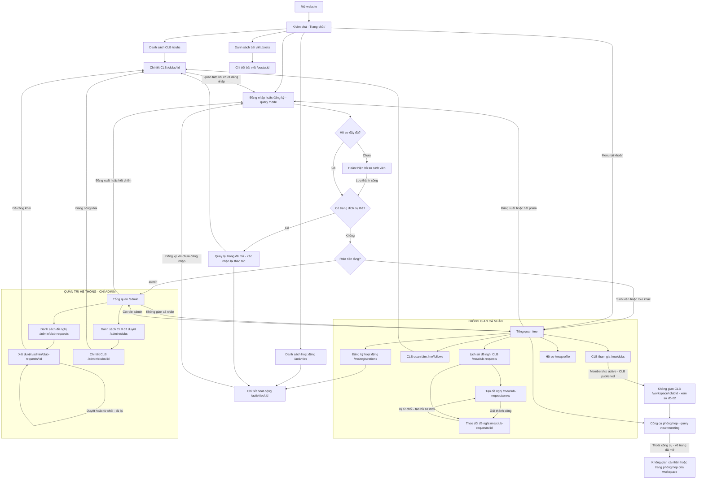
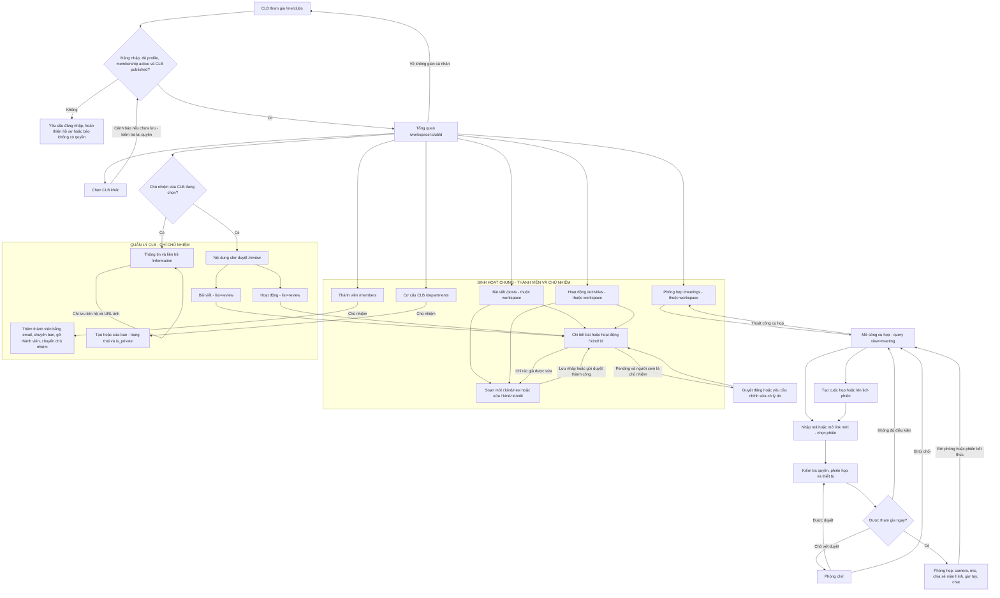
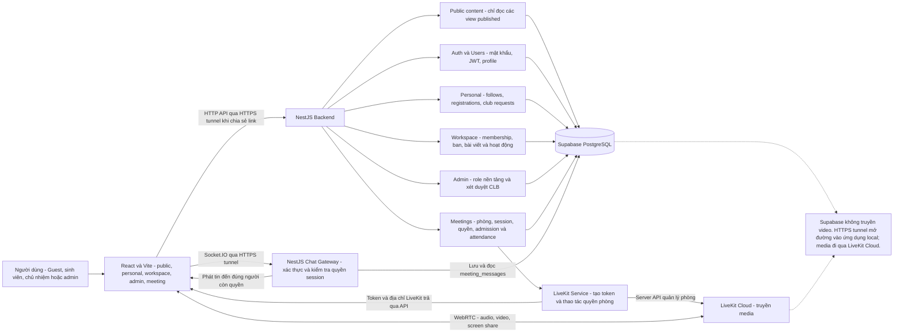

# Sơ đồ uniCircle — Mermaid

Ngày 16/11/2026. Xem README.md trong cùng thư mục để biết cách import và giới hạn hiện tại.

## 1. Chuyển màn hình tổng thể

## 2. Workspace và meeting

## 3. Luồng nghiệp vụ hệ thống

```mermaid
flowchart TB
    START["Người dùng truy cập website"] --> READ["Frontend gọi API public để xem CLB, bài viết, hoạt động"]
    READ --> ACTION{"Muốn thao tác cần tài khoản?"}
    ACTION -->|"Không"| READ
    ACTION -->|"Có"| ACCOUNT{"Có phiên đăng nhập hợp lệ?"}
    ACCOUNT -->|"Chưa"| AUTH["Đăng ký hoặc đăng nhập qua NestJS"]
    AUTH --> USERDB["Đọc hoặc tạo users - kiểm tra mật khẩu - cấp JWT ứng dụng"]
    USERDB --> PROFILE{"Hồ sơ sinh viên đã đủ?"}
    ACCOUNT -->|"Có"| PROFILE
    PROFILE -->|"Chưa"| COMPLETE["Bổ sung student_profiles và lưu thành công"]
    COMPLETE --> READY
    PROFILE -->|"Rồi"| READY["Tài khoản sẵn sàng - quay lại đích hoặc vào trang mặc định theo role"]

    READY --> FOLLOW["Quan tâm hoặc bỏ quan tâm CLB"]
    FOLLOW --> FOLLOWS_DB["API ghi club_follows theo user hiện tại và CLB published"]
    READY --> REGISTER["Đăng ký hoặc hủy đăng ký hoạt động"]
    REGISTER --> REGISTER_CHECK{"Hoạt động, thời hạn và sức chứa hợp lệ?"}
    REGISTER_CHECK -->|"Có"| REG_DB["Ghi hoặc cập nhật activity_registrations - giữ lịch sử hủy"]
    REGISTER_CHECK -->|"Không"| REG_ERROR["Báo lý do và tải lại trạng thái"]

    READY --> CLUB_REQUEST["Sinh viên gửi đề nghị thành lập CLB"]
    CLUB_REQUEST --> PENDING["Tạo clubs status=pending - trigger khởi tạo ban và chủ nhiệm"]
    PENDING --> ADMIN["Admin đọc hồ sơ - JWT, profile và role được kiểm tra ở backend"]
    ADMIN --> DECISION{"Quyết định xét duyệt"}
    DECISION -->|"Từ chối - cần lý do"| REJECT["Conditional UPDATE sang rejected - lưu người duyệt, thời gian và lý do"]
    REJECT --> OWNER["Người gửi xem kết quả - có thể tạo đề nghị mới"]
    OWNER --> CLUB_REQUEST
    DECISION -->|"Duyệt"| STRUCTURE{"Cấu trúc chủ nhiệm và Ban quản trị hợp lệ?"}
    STRUCTURE -->|"Không"| FIX["Báo xung đột - kiểm tra dữ liệu khởi tạo"]
    STRUCTURE -->|"Có"| PUBLISH["Conditional UPDATE pending và đúng updated_at sang published"]
    PUBLISH --> PUBLIC["Public views đưa CLB vào trang khám phá khi tải lại"]
    PUBLISH --> WORKSPACE["Membership active được mở workspace của CLB published"]

    READY --> MEMBER_CHECK{"Là thành viên active của CLB published?"}
    MEMBER_CHECK -->|"Có"| WORKSPACE
    MEMBER_CHECK -->|"Không"| NO_MEMBER["Không truy cập dữ liệu nội bộ CLB"]
    WORKSPACE --> CONTENT["Tác giả soạn bài hoặc hoạt động - lưu draft"]
    CONTENT --> SUBMIT["Gửi đúng phiên bản draft sang pending_review"]
    SUBMIT --> AUTO{"Hoạt động do chủ nhiệm tạo?"}
    AUTO -->|"Có"| APPROVE["Duyệt đăng với quyền chủ nhiệm"]
    AUTO -->|"Không"| CHAIR["Chủ nhiệm xem hàng đợi đúng CLB"]
    CHAIR --> REVIEW{"Kết quả xét duyệt"}
    REVIEW -->|"Yêu cầu sửa - cần lý do"| CHANGES["changes_requested hoặc rejected ở schema legacy"]
    CHANGES --> CONTENT
    REVIEW -->|"Duyệt"| APPROVE
    APPROVE --> VISIBILITY{"Nội dung được công khai?"}
    VISIBILITY -->|"Hoạt động hoặc bài viết public"| PUBLIC_CONTENT["Public view chỉ trả nội dung published của CLB published"]
    VISIBILITY -->|"Bài viết internal"| PRIVATE_CONTENT["Chỉ đọc trong workspace có membership hợp lệ"]
    CONTENT -->|"Sửa nội dung đã đăng"| HIDE["Đưa về draft và ẩn bản công khai cho tới khi duyệt lại"]
    HIDE --> SUBMIT
    WORKSPACE --> PEOPLE["Chủ nhiệm quản lý ban, thành viên và liên hệ - chuyển chủ nhiệm qua RPC"]

    READY --> MEETING["Mở công cụ meeting - quyền họp độc lập với role CLB"]
    WORKSPACE --> MEETING
    MEETING --> PERMISSION["Backend kiểm tra phiên họp, quyền thành viên và điều kiện tiếp nhận"]
    PERMISSION --> TOKEN["Cấp token LiveKit có quyền của cuộc họp"]
    TOKEN --> MEDIA["Trình duyệt kết nối LiveKit Cloud - camera, mic và màn hình"]
    MEDIA --> CHAT["Socket.IO xác thực JWT và quyền session - lưu meeting_messages rồi phát tin"]
    CHAT --> LEAVE["Rời phòng hoặc phiên kết thúc - cập nhật tham dự và thu hồi quyền truy cập"]
    LEAVE --> RETURN["Về công cụ họp hoặc trang trước đó"]

    PUBLISH -.-> CONFLICT["Nếu trạng thái hoặc updated_at đã đổi: trả 409, tải lại trước khi quyết định"]
    APPROVE -.-> CONFLICT
```

## 4. Kiến trúc kỹ thuật

